# dan-ui

<p align="center">
  <strong>Vue 3</strong> 通用 UI 组件库 · 中后台 · 表格表单 · AI 对话壳 · 富文本
</p>

<p align="center">
  <a href="https://www.npmjs.com/package/@dandan-ui/ui"></a>
  <a href="https://dandanhub.vip/dan-ui/"></a>
  <a href="LICENSE"></a>
</p>

<p align="center">
  <a href="https://dandanhub.vip/dan-ui/">在线文档</a>
  ·
  <a href="https://www.npmjs.com/package/@dandan-ui/ui">@dandan-ui/ui</a>
  ·
  <a href="https://www.npmjs.com/package/@dandan-ui/theme">@dandan-ui/theme</a>
</p>

dan-ui 面向 **中后台与 AI 应用界面**：表单 / 表格 / 浮层 / Chat 壳 / TipTap 富文本，一套主题 Token。  
**不做**大模型 SDK、图表库、云厂商上传 SDK。

下面截图均来自官方文档站实拍（[dandanhub.vip/dan-ui](https://dandanhub.vip/dan-ui/)）。

---

## 文档站首页

亮色与暗色同一套组件与 Token，顶栏可切换主题。

| 亮色 | 暗色 |
|:---:|:---:|
| 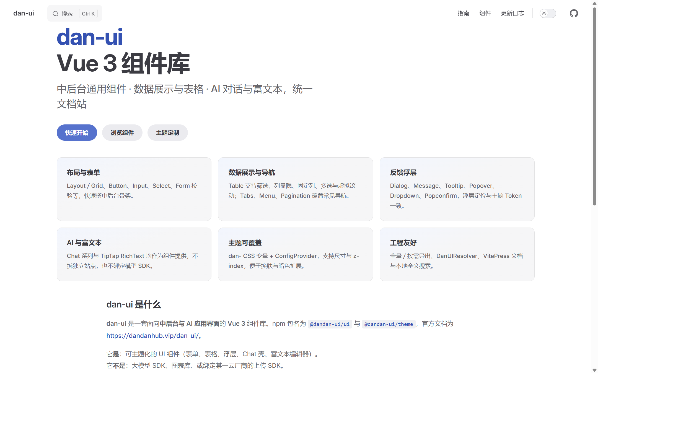 | 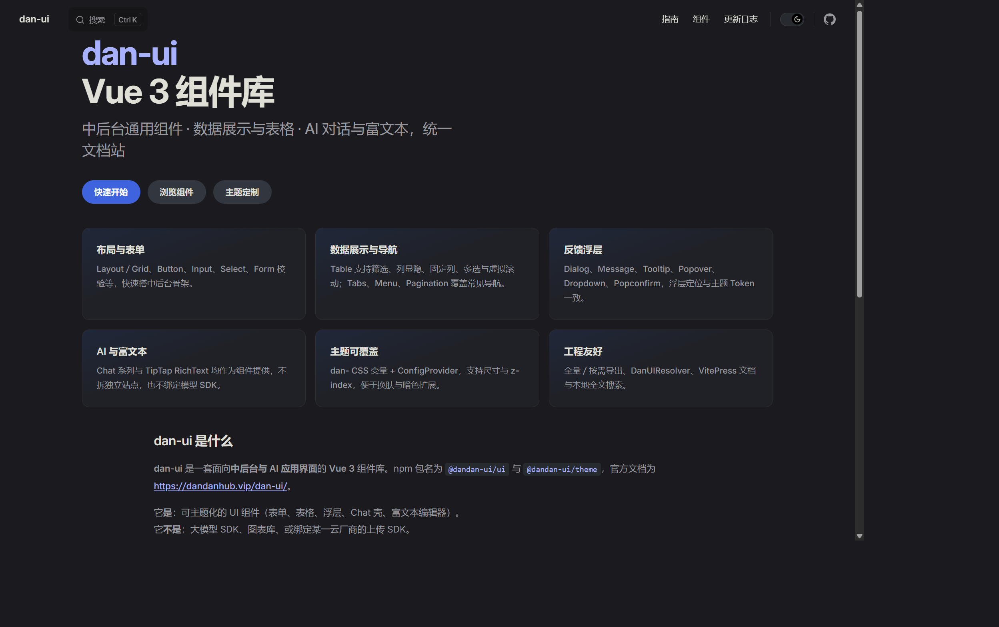 |

---

## 中后台：布局 · 表单 · 录入

搭后台骨架（Layout）+ 校验表单（Form）+ 常见录入控件。

| Layout 布局 | Form 表单 |
|:---:|:---:|
| 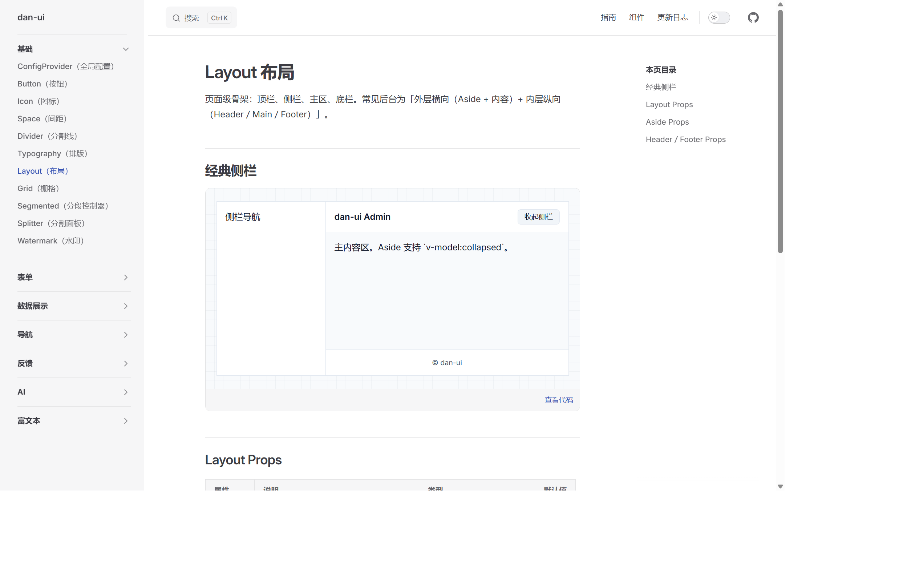 | 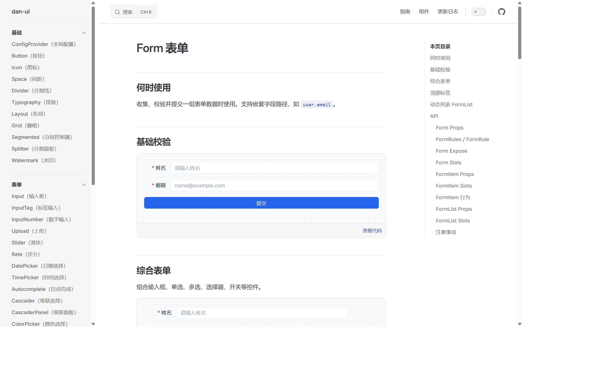 |

| Select 选择器 | DatePicker 日期 |
|:---:|:---:|
| 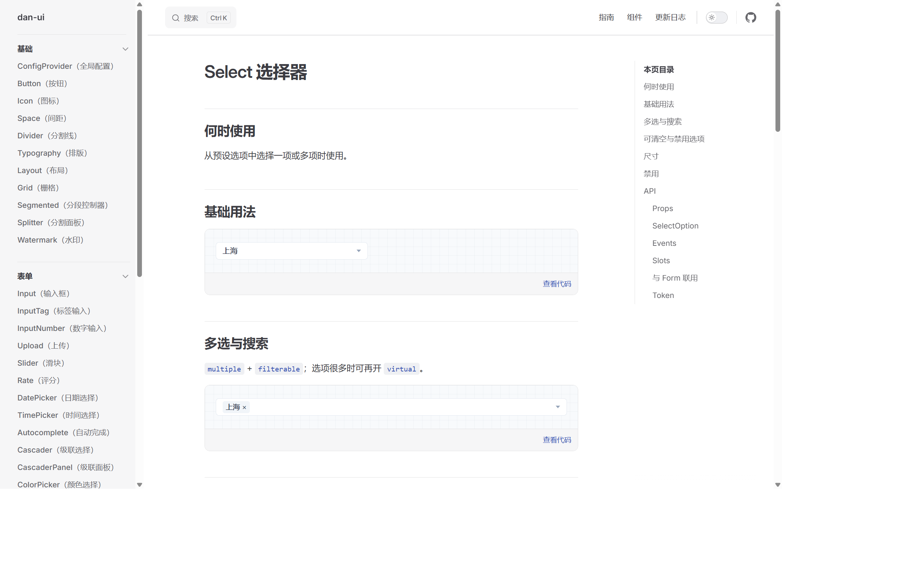 | 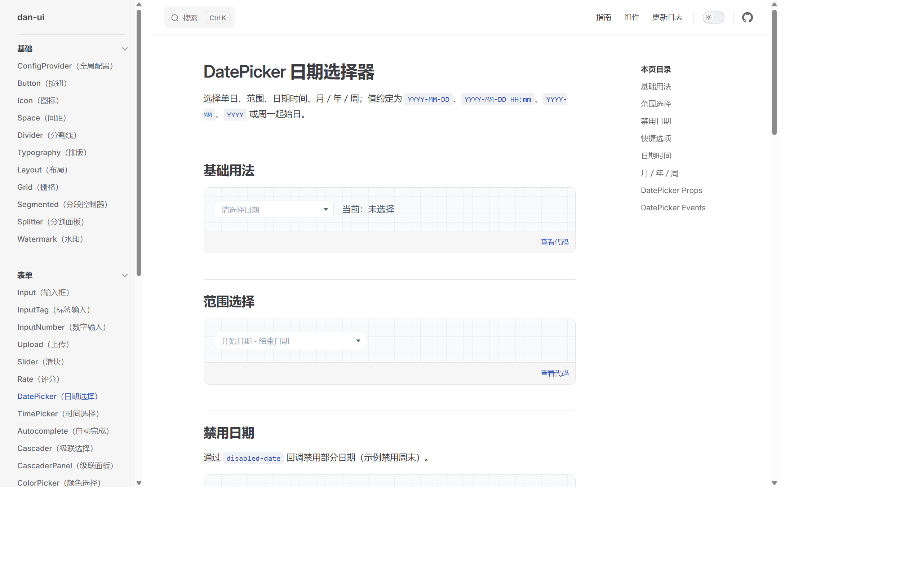 |

| Upload 上传 | Button 按钮 |
|:---:|:---:|
| 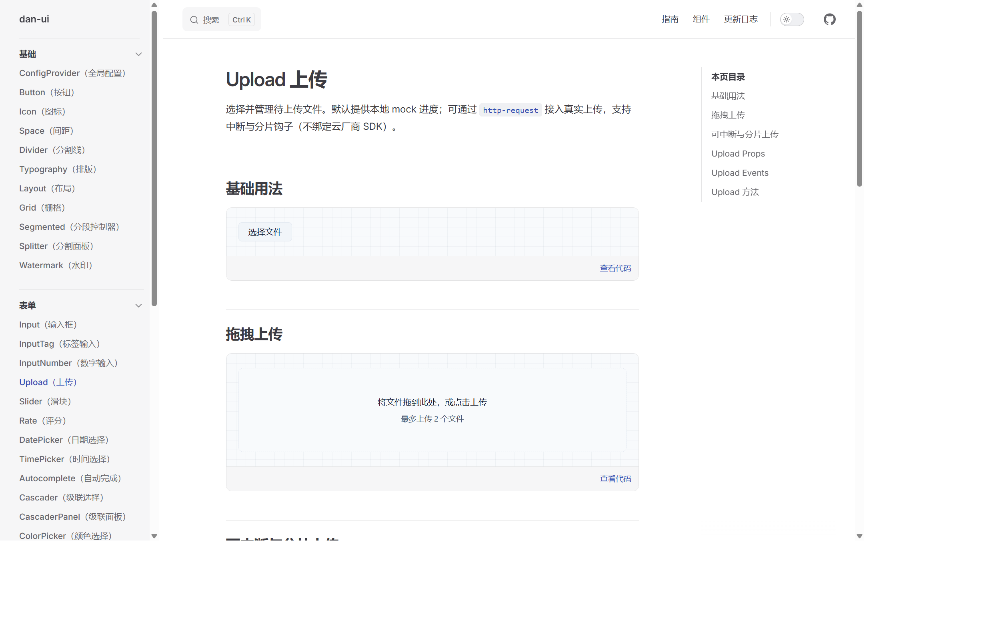 | 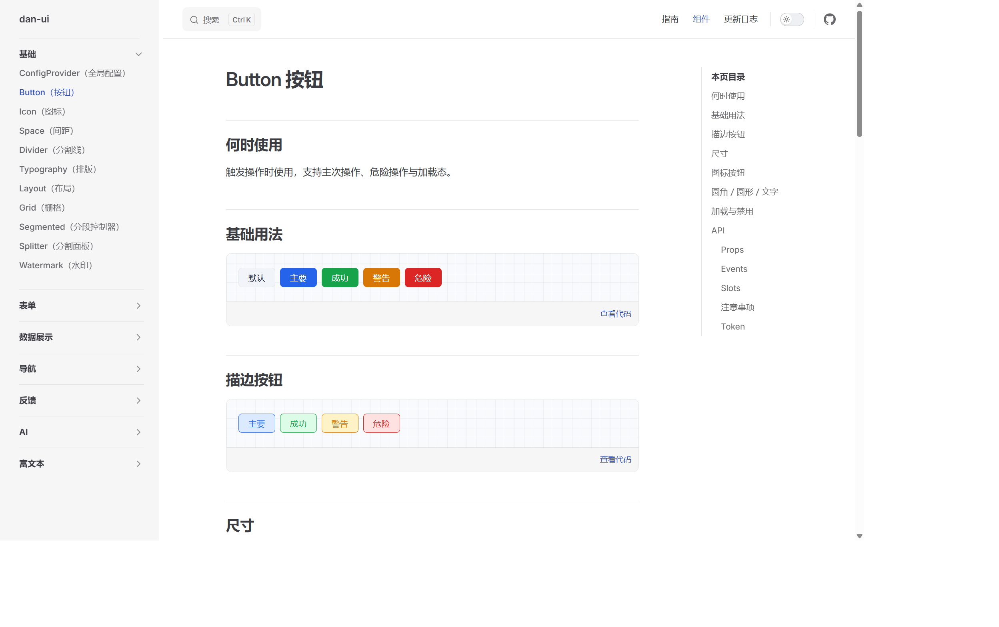 |

---

## 数据展示：表格 · 树 · 图片

Table 支持筛选、列显隐、固定列、多选、虚拟滚动等；Tree / Image 覆盖常见展示。

| Table 表格 | Tree 树 |
|:---:|:---:|
| 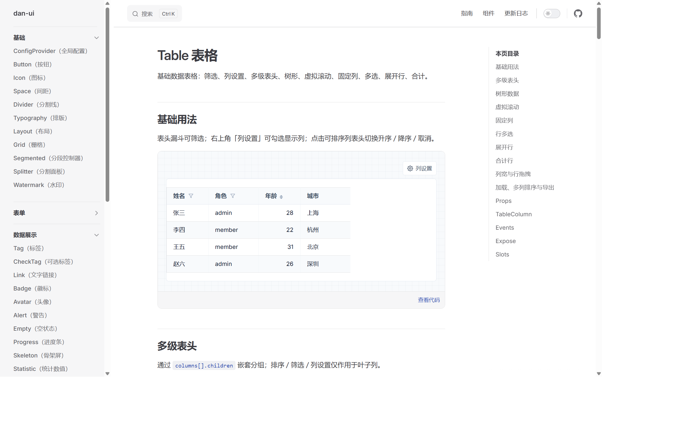 | 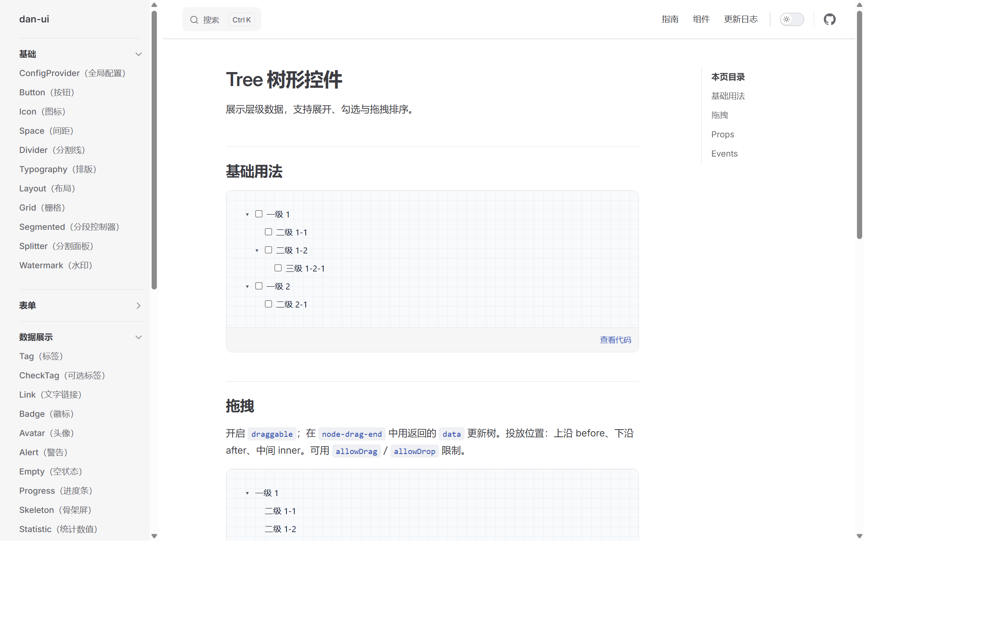 |

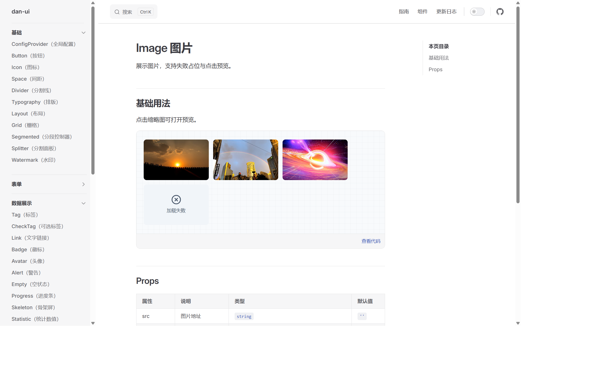

---

## 反馈浮层

Dialog / Message / Drawer 等与主题 Token 一致，文档内可直接点开 Demo。

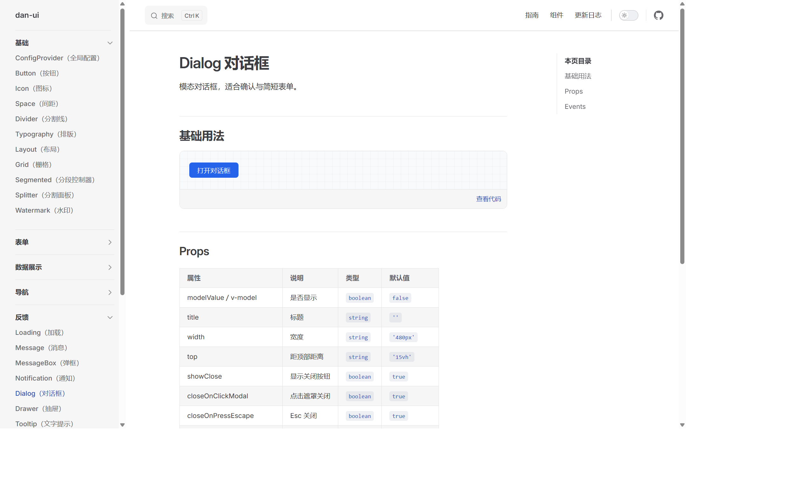

---

## AI 对话壳（不绑模型）

只提供界面与事件：消息列表、流式文本、工具卡片等；模型请求由业务侧接入。

| AI 概览 / 假流式 Demo | Chat 对话容器 |
|:---:|:---:|
| 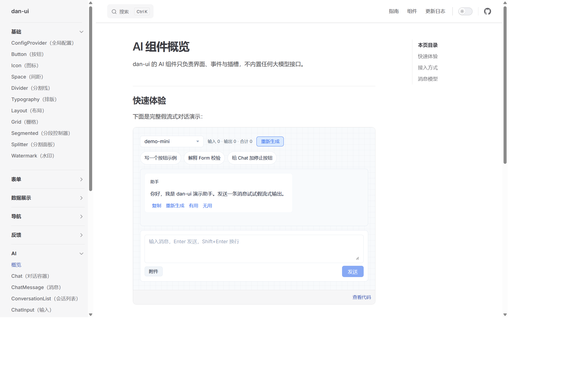 | 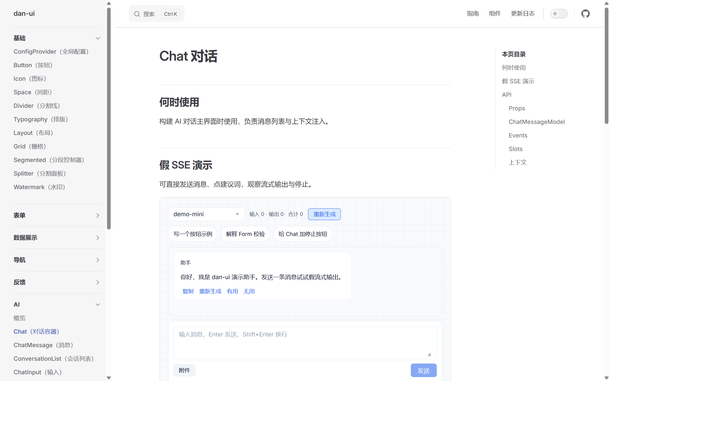 |

---

## 富文本

基于 TipTap 的 `RichText`，工具栏与气泡菜单开箱可用。

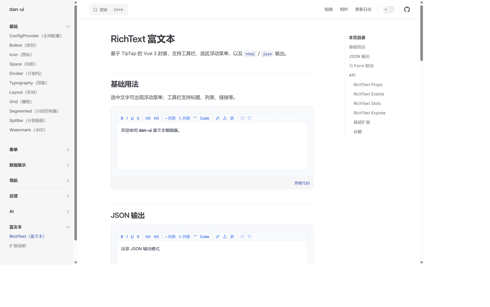

---

## 特性速览

- **Vue 3.5+ / TypeScript**：全量 `app.use(DanUI)` 或按需 / `DanUIResolver`
- **CSS 变量主题**：`@dandan-ui/theme` + `--dan-*`，支持暗色
- **中后台面齐全**：Layout、Form、Table、浮层、导航、上传日期选择等
- **AI 只做壳**：Chat / ToolCallCard / Artifact 等，不内置 LLM
- **富文本**：TipTap peer 依赖，html / json（及文档中的 markdown 能力）

完整交互请打开文档：[组件](https://dandanhub.vip/dan-ui/components/button) · [AI](https://dandanhub.vip/dan-ui/ai/overview) · [Changelog](https://dandanhub.vip/dan-ui/guide/changelog)

---

## 安装

```bash
pnpm add @dandan-ui/ui @dandan-ui/theme
```

使用富文本时额外安装 TipTap peer：

```bash
pnpm add @tiptap/vue-3 @tiptap/starter-kit @tiptap/extension-placeholder @tiptap/extension-image @tiptap/pm
```

### 全量注册

```ts
import { createApp } from 'vue'
import DanUI from '@dandan-ui/ui'
import '@dandan-ui/theme'
import '@dandan-ui/ui/style.css'
import App from './App.vue'

createApp(App).use(DanUI).mount('#app')
```

### 按需引入

```ts
import { DanButton, DanInput, DanForm } from '@dandan-ui/ui'
import '@dandan-ui/theme'
import '@dandan-ui/ui/style.css'
```

配合 `unplugin-vue-components`：

```ts
import Components from 'unplugin-vue-components/vite'
import { DanUIResolver } from '@dandan-ui/ui/resolver'

export default {
  plugins: [
    Components({
      resolvers: [DanUIResolver()],
    }),
  ],
}
```

| 样式引入 | 作用 |
|------|------|
| `@dandan-ui/theme` | CSS 变量 Token |
| `@dandan-ui/ui/style.css` | 组件样式 |

覆盖示例：`--dan-color-primary`。详见 [主题定制](https://dandanhub.vip/dan-ui/guide/theming)。

---

## 本地开发

```bash
pnpm install
pnpm build
pnpm dev:play   # playground
pnpm dev:docs   # http://localhost:5173/dan-ui/
```

| 脚本 | 说明 |
|------|------|
| `pnpm build` | 构建 theme + ui |
| `pnpm test` | 单元测试 |
| `pnpm lint` | ESLint + Prettier |
| `pnpm gen <name>` | 组件脚手架 |
| `pnpm docs:build` | 构建文档站 |

```text
packages/ui      组件
packages/theme   Token
docs/            VitePress（含 public/readme 截图）
playground/      联调
```

文档部署：`base` 为 `/dan-ui/`；Cloudflare Pages 输出 `docs/.vitepress/dist`，由 dandanhub Worker 反代 `/dan-ui/*`。

---

## 能力一览

- **基础**：ConfigProvider、Button、Icon、Space、Typography、主题 Token
- **表单**：Input / Select / Cascader / DatePicker / Upload / Form / FormList …
- **数据**：Table、Tree、Image、Calendar、Carousel、Descriptions …
- **反馈**：Dialog、Drawer、Message、Notification、Tooltip、Popconfirm、Tour …
- **AI**：Chat、ChatWorkspace、ToolCallCard、AgentSteps、MediaPreview、PromptTemplate …
- **富文本**：RichText、EditorToolbar、EditorBubbleMenu

---

## License

[MIT](./LICENSE)
